## 1. Use Case Diagram (PlantUML – UML)

```plantuml
@startuml
left to right direction
skinparam packageStyle rectangle
actor Administrator as Admin
actor "Content Manager" as CM
actor Visitor
actor "Dịch vụ dịch tự động" as MT
actor "Dịch vụ TTS" as TTS

rectangle "Hệ thống thuyết minh tự động đa ngôn ngữ" {

  usecase "UC01 - Đăng nhập" as U01
  usecase "UC02 - Đăng xuất" as U02
  usecase "UC03 - Đổi mật khẩu" as U03
  usecase "UC04 - Khôi phục mật khẩu" as U04
  usecase "UC05 - Quản lý tài khoản nhân sự" as U05
  usecase "UC06 - Xem danh sách và chi tiết địa điểm" as U06
  usecase "UC07 - Quản lý địa điểm" as U07
  usecase "UC08 - Xem danh sách và chi tiết POI" as U08
  usecase "UC09 - Quản lý POI" as U09
  usecase "UC10 - Quản lý ngôn ngữ" as U10
  usecase "UC11 - Thiết lập giọng đọc mặc định theo ngôn ngữ" as U11
  usecase "UC12 - Xem danh sách và chi tiết nội dung thuyết minh" as U12
  usecase "UC13 - Tạo nội dung thuyết minh" as U13
  usecase "UC14 - Cập nhật và gửi duyệt nội dung thuyết minh" as U14
  usecase "UC15 - Kiểm duyệt và xuất bản nội dung" as U15
  usecase "UC16 - Gỡ xuất bản và xuất bản lại nội dung" as U16
  usecase "UC17 - Yêu cầu dịch tự động" as U17
  usecase "UC18 - Rà soát và chỉnh sửa bản dịch" as U18
  usecase "UC19 - Chọn giọng đọc" as U19
  usecase "UC20 - Yêu cầu tạo audio TTS" as U20
  usecase "UC21 - Nghe thử audio" as U21
  usecase "UC22 - Quản lý audio" as U22
  usecase "UC23 - Truy cập trang web thuyết minh" as U23
  usecase "UC24 - Chọn ngôn ngữ sử dụng" as U24
  usecase "UC25 - Duyệt và chọn địa điểm tham quan" as U25
  usecase "UC26 - Xem danh sách POI" as U26
  usecase "UC27 - Xem nội dung thuyết minh" as U27
  usecase "UC28 - Nghe thuyết minh" as U28
  usecase "UC29 - Điều khiển trình phát audio" as U29
  usecase "UC30 - Chuyển ngôn ngữ thuyết minh" as U30
  usecase "UC31 - Xem lịch sử nghe trên thiết bị" as U31
  usecase "UC32 - Quản lý QR Code cho POI" as U32
  usecase "UC33 - Quét QR Code và truy cập POI" as U33
  usecase "UC34 - Xem thống kê hoạt động" as U34
}
Admin -- U01
CM -- U01
Admin -- U02
CM -- U02
Admin -- U03
CM -- U03
Admin -- U04
CM -- U04
Admin -- U05
Admin -- U06
CM -- U06
Admin -- U07
Admin -- U08
CM -- U08
Admin -- U09
CM -- U09
Admin -- U10
Admin -- U11
Admin -- U12
CM -- U12
Admin -- U13
CM -- U13
Admin -- U14
CM -- U14
Admin -- U15
Admin -- U16
Admin -- U17
CM -- U17
MT -- U17
Admin -- U18
CM -- U18
Admin -- U19
CM -- U19
Admin -- U20
CM -- U20
TTS -- U20
Admin -- U21
CM -- U21
Admin -- U22
CM -- U22
Visitor -- U23
Visitor -- U24
Visitor -- U25
Visitor -- U26
Visitor -- U27
Visitor -- U28
Visitor -- U29
Visitor -- U30
Visitor -- U31
Admin -- U32
CM -- U32
Visitor -- U33
Admin -- U34
' U19 .> U20 : <<extend>>
@enduml
```

~~`U19 .> U20 : <<extend>>`~~
**[ĐÃ SỬA 16/11] (loại bỏ vì tài liệu gốc không có, mã D1)**

~~> Chỉ vẽ một quan hệ `extend`: UC19 → UC20, vì UC20 bước 3 mô tả việc đổi giọng đọc (UC19) là bước tùy chọn, và bắt buộc khi ngôn ngữ chưa có giọng mặc định. Không vẽ `include`/`extend` khác vì đặc tả chỉ mô tả các UC liên quan và điều hướng nghiệp vụ. Không gán MT/TTS vào các UC khác ngoài UC17/UC20.~~
**[ĐÃ SỬA 16/11] (loại bỏ vì tài liệu gốc không có, mã D1)**

