## 3. State Diagram – vòng đời Content Version

```mermaid
stateDiagram-v2
    [*] --> Draft: Tạo nội dung (UC13); sửa bản đã phát hành (UC14); dịch tự động (UC17)
    Draft --> PendingReview: Content Manager gửi duyệt (UC14)
    Draft --> Published: Administrator xuất bản trực tiếp (UC14)
    PendingReview --> Draft: Content Manager thu hồi (UC14)
    PendingReview --> Published: Administrator phê duyệt (UC15)
    PendingReview --> Rejected: Administrator từ chối kèm lý do (UC15)
    Rejected --> Draft: Sửa và lưu (UC14)
    Rejected --> PendingReview: Content Manager gửi duyệt lại (UC14)
    Rejected --> Published: Administrator xuất bản trực tiếp (UC14)
    Published --> Removed: Administrator gỡ, có lý do (UC16)
    Removed --> Published: Administrator xuất bản lại (UC16)
    Published --> Superseded: Version mới được xuất bản (UC14/UC15)
    Removed --> Superseded: Version mới được xuất bản (UC14/UC15)
    Draft --> [*]: Xóa bản nháp (UC14)
    Rejected --> [*]: Xóa bản bị từ chối (UC14)
```

**Các bất biến phải kiểm tra ở backend**
1. Mỗi Content có tối đa một version thuộc nhóm đang soạn `{Draft, PendingReview, Rejected}`.
2. Mỗi Content có tối đa một version thuộc nhóm đã phát hành `{Published, Removed}`.
3. `PendingReview` và `Published` không sửa tại chỗ.
4. `Superseded` chỉ để tra cứu lịch sử.
5. Audio gắn với version (mỗi version một bản ghi audio). Version mới tạo từ bản đã phát hành kế thừa audio bằng bản ghi mới trỏ cùng tệp. Thay đổi narration text làm audio của version đang soạn lỗi thời; chỉ đổi title thì không.
6. Chỉ version `Draft` hoặc `Rejected` được gửi duyệt hoặc xuất bản trực tiếp. Trước khi gửi duyệt, xuất bản trực tiếp, phê duyệt và xuất bản lại phải kiểm tra đủ 5 điều kiện xuất bản trong đặc tả.
7. `NeedsReview` là cờ độc lập trên nội dung bản dịch, không phải state trong state machine này.

**Lưu ý về xóa:** trạng thái `(deleted)` không phải trạng thái lưu trữ; sơ đồ thể hiện kết thúc vòng đời của Draft/Rejected khi bị xóa. Đặc tả không cho xóa nội dung đã từng phát hành.

