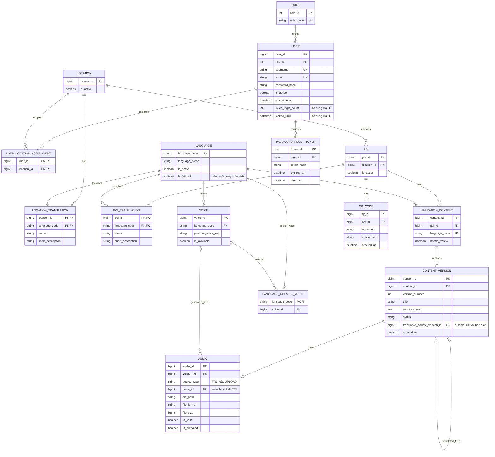

## 4. ERD logic

**[ĐÃ SỬA 16/11] (bổ sung, mã D7)** Bổ sung các trường `failed_login_count` (số lần đăng nhập sai liên tiếp), `locked_until` (thời điểm hết khóa tạm) vào thực thể `USER`, và thực thể `PASSWORD_RESET_TOKEN` (mã/liên kết khôi phục có thời hạn) để đáp ứng yêu cầu khóa tạm thời khi sai nhiều lần (UC01 mục 5.3, Tham số 5.2) và khôi phục mật khẩu (UC04 mục Yêu cầu).

~~VOICE o|--o{ CONTENT_VERSION : selected_for~~
~~bigint selected_voice_id FK "nullable, đề xuất"~~
**[ĐÃ SỬA 16/11] (loại bỏ vì tài liệu gốc không có, mã D8)** Tài liệu gốc mục 1.1 và UC19/UC20 chỉ quy định audio gắn với phiên bản nội dung và đổi giọng đọc trước khi tạo audio, không quy định lưu khóa ngoại giọng đọc độc lập trong bảng phiên bản nội dung.

~~CONTENT_VERSION ||--o{ REVIEW_HISTORY : review_events~~
~~USER ||--o{ REVIEW_HISTORY : acts~~
~~REVIEW_HISTORY { bigint review_id PK ... }~~
**[ĐÃ SỬA 16/11] (loại bỏ vì tài liệu gốc không có, mã D9)** Tài liệu gốc chỉ yêu cầu "Hệ thống lưu lịch sử kiểm duyệt kèm lý do từ chối", không quy định schema thực thể quan hệ và không có các sự kiện kỹ thuật mở rộng như SUBMIT hay WITHDRAW.

~~POI o|--o{ ACTIVITY_EVENT : observed~~
~~LOCATION o|--o{ ACTIVITY_EVENT : observed~~
~~LANGUAGE o|--o{ ACTIVITY_EVENT : observed~~
~~QR_CODE o|--o{ ACTIVITY_EVENT : scanned~~
~~ACTIVITY_EVENT { bigint event_id PK ... }~~
**[ĐÃ SỬA 16/11] (loại bỏ vì tài liệu gốc không có, mã D10)** Tài liệu gốc mục 0 và mục 5 ghi rõ "đặc tả không quy định định dạng event analytics hay schema database"; thực thể sự kiện là mô hình kỹ thuật do AI tự đề xuất, không có trong đặc tả gốc.

### 4.1. Ràng buộc dữ liệu quan trọng

- `NARRATION_CONTENT`: unique `(poi_id, language_code)`. Cờ `needs_review` gắn với nội dung, không gắn với version.
- `CONTENT_VERSION`: unique `(content_id, version_number)`. `translation_source_version_id` nằm ở từng version của bản dịch để biết mỗi lần dịch dùng nguồn nào.
- Partial unique constraints (hoặc transaction/locking tương đương) để bảo đảm tối đa một version đang soạn và tối đa một version phát hành cho mỗi Content.
- `AUDIO`: unique `version_id`, mỗi version một bản ghi audio. Version mới kế thừa audio bằng bản ghi mới trỏ cùng `file_path`; tệp chỉ bị xóa khi không còn bản ghi nào tham chiếu. Cờ lỗi thời chỉ nằm ở `AUDIO.is_outdated` để tránh hai nguồn sự thật.
- `AUDIO.voice_id` chỉ có giá trị khi `source_type = TTS`; audio tải lên không có voice.
- `LOCATION_TRANSLATION` và `POI_TRANSLATION`: khóa chính theo cặp (đối tượng, ngôn ngữ); bắt buộc có bản tiếng Anh theo quy tắc nghiệp vụ.
- `LANGUAGE`: đúng một ngôn ngữ có `is_fallback = true` (English), luôn `is_active`.
- `LANGUAGE_DEFAULT_VOICE`: tối đa một voice mặc định cho mỗi ngôn ngữ; voice phải thuộc đúng ngôn ngữ.
- `USER_LOCATION_ASSIGNMENT`: khóa chính `(user_id, location_id)`.
- `QR_CODE`: unique `poi_id` nếu quy tắc "mỗi POI một QR Code" được áp dụng như mô hình hiện tại.
- Không lưu lịch sử nghe Visitor trên server: đặc tả yêu cầu Local Storage, không đăng nhập và không đồng bộ thiết bị.

### 4.2. Phần cần xác nhận / đề xuất mô hình

1. **Analytics:** `ACTIVITY_EVENT` là đề xuất, đặc tả chưa quy định schema. Không lưu tên, email, tài khoản hay định danh cá nhân Visitor.
2. **Voice override:** `CONTENT_VERSION.selected_voice_id` là đề xuất để lưu lựa chọn trước khi audio được tạo; `AUDIO.voice_id` ghi voice thực tế đã dùng.
3. **Review history:** `REVIEW_HISTORY.event_type` là đề xuất để lưu cả gửi duyệt, thu hồi, duyệt, từ chối, xuất bản, gỡ, xuất bản lại. Thời hạn lưu chưa quy định.
4. **Authentication:** reset token, bộ đếm đăng nhập sai, thời điểm hết khóa tạm và session store chưa vẽ thành entity vì đặc tả chưa yêu cầu ERD chi tiết cho hạ tầng xác thực.
5. **File storage:** `file_path` là tham chiếu đến kho file, không phải lưu binary trực tiếp trong bảng quan hệ.

