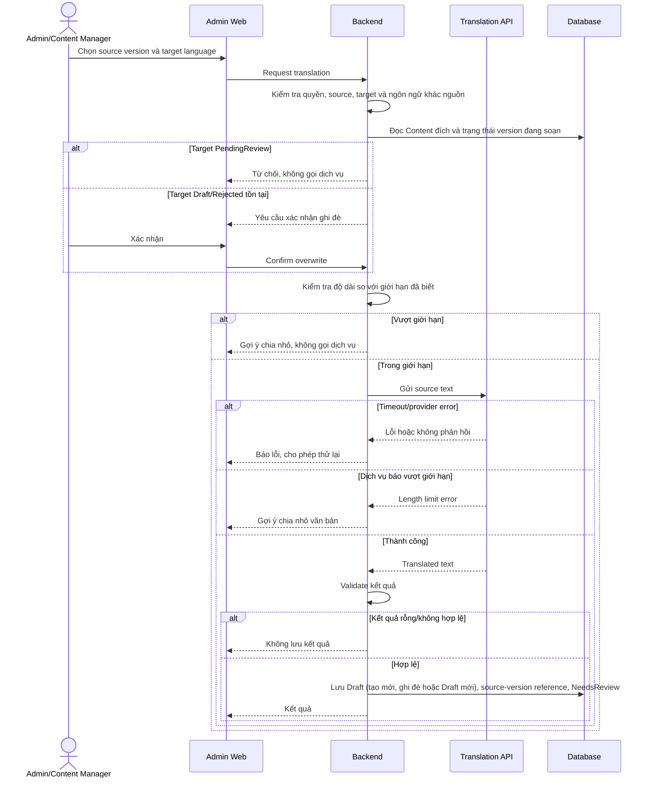
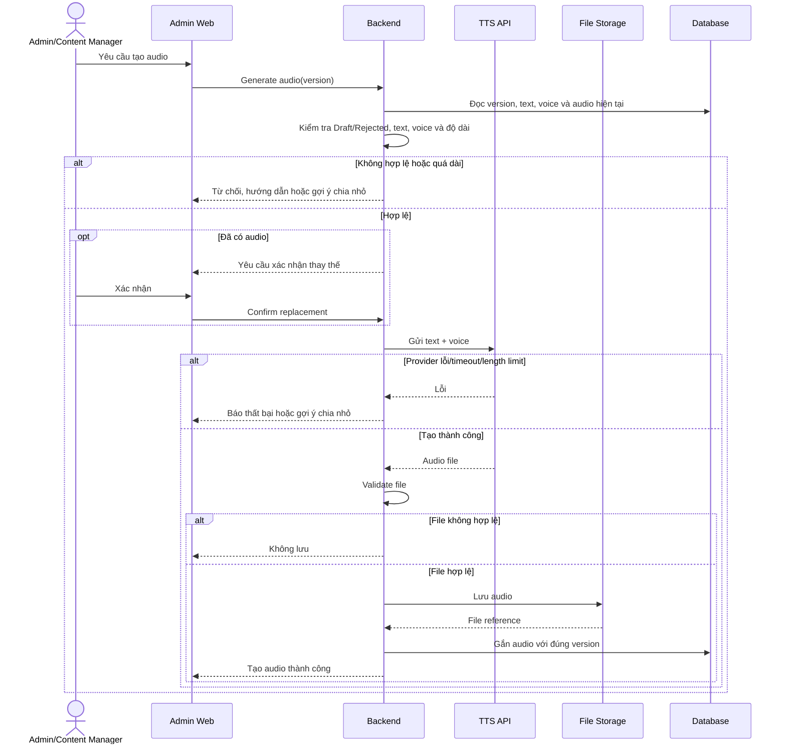
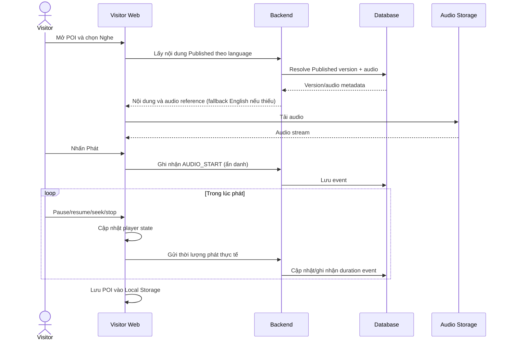
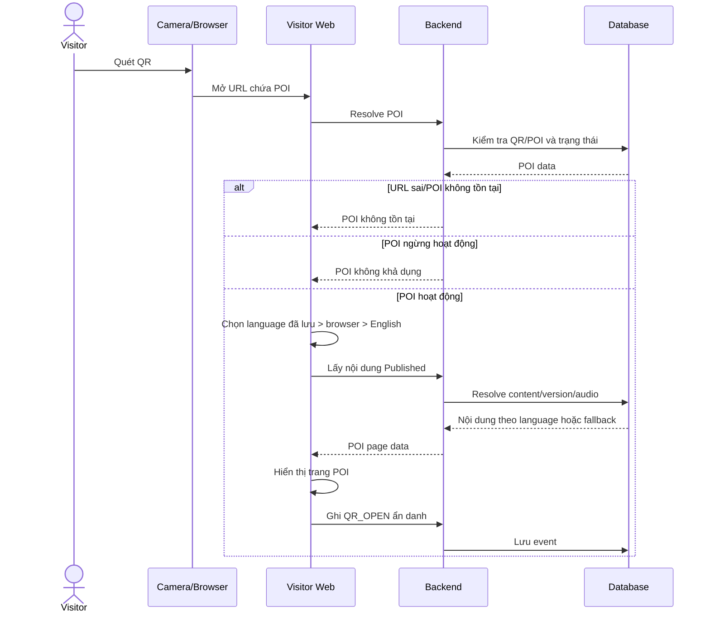

~~## 5. Sequence Diagram – các luồng liên thành phần trọng yếu~~
**[ĐÃ SỬA 16/11] (loại bỏ vì tài liệu gốc không có, mã D11)** ## 5. Sequence Diagram – các luồng liên thành phần trọng yếu
*(Ghi chú: Tài liệu gốc `dac_ta_use_case_hoan_chinh_v2.docx` chỉ là đặc tả Use Case nghiệp vụ, không quy định Sequence Diagram hay phân tầng kỹ thuật Client-API-DB. Mục 5 được giữ lại dưới dạng đề xuất thiết kế kỹ thuật cho giai đoạn hiện thực hóa hệ thống).*

### 5.1. UC14 – Content Manager gửi duyệt / Administrator xuất bản trực tiếp

```mermaid
sequenceDiagram
    actor U as Người dùng
    participant UI as Admin Web
    participant API as Backend
    participant DB as Database
    U->>UI: Mở Content, chỉnh sửa và lưu
    UI->>API: Save version
    API->>API: Kiểm tra quyền và trạng thái
    API->>DB: Update Draft hoặc tạo Draft mới kế thừa audio
    API->>DB: Đánh dấu audio outdated nếu narration text đổi
    DB-->>API: Kết quả lưu
    API-->>UI: Lưu thành công
    U->>UI: Gửi duyệt hoặc xuất bản phiên bản Draft/Rejected
    UI->>API: Submit/Publish
    API->>API: Kiểm tra có version đang soạn và 5 điều kiện xuất bản
    alt Không đủ điều kiện
        API-->>UI: Từ chối, giữ nguyên trạng thái và trả lý do
    else Content Manager
        API->>DB: Chuyển PendingReview và ghi SUBMIT vào lịch sử
        API-->>UI: Đã gửi duyệt
    else Administrator
        API->>DB: Publish version; supersede bản phát hành cũ
        API->>DB: Đánh dấu NeedsReview cho bản dịch nếu narration text khác bản trước
        API->>DB: Lưu lịch sử và cập nhật bản Visitor
        API-->>UI: Xuất bản thành công
    end
```

### 5.2. UC15 – Kiểm duyệt

```mermaid
sequenceDiagram
    actor Admin
    participant UI as Admin Web
    participant API as Backend
    participant DB as Database
    Admin->>UI: Mở hàng đợi kiểm duyệt
    UI->>API: Lấy PendingReview
    API->>DB: Query versions
    DB-->>API: Danh sách
    API-->>UI: Danh sách chờ duyệt
    Admin->>UI: Chọn version và xem nội dung/audio
    UI->>API: Lấy chi tiết version
    API->>DB: Đọc content, audio, version phát hành
    DB-->>API: Dữ liệu đối chiếu
    API-->>UI: Chi tiết
    Admin->>UI: Phê duyệt hoặc từ chối
    alt Phê duyệt
        UI->>API: Approve
        API->>API: Kiểm tra trạng thái mới nhất và 5 điều kiện
        alt Hợp lệ
            API->>DB: Published; supersede version cũ
            API->>DB: Mark translations NeedsReview nếu source text đổi
            API->>DB: Ghi review history và cập nhật Visitor
            API-->>UI: Published
        else Không hợp lệ
            API-->>UI: Giữ PendingReview, trả lý do
        end
    else Từ chối
        Admin->>UI: Nhập lý do
        UI->>API: Reject(reason)
        API->>DB: Rejected + review history
        API-->>UI: Cập nhật trạng thái/lý do
    end
```

### 5.3. UC17 – Dịch tự động



### 5.4. UC20 – Tạo audio TTS



### 5.5. UC28/UC29 – Visitor phát và điều khiển audio



> Payload event, tần suất gửi duration, session key và cơ chế chống ghi trùng chưa được đặc tả; sequence chỉ biểu diễn điểm tích hợp logic, không chốt giao thức.

### 5.6. UC33 – Quét QR Code



