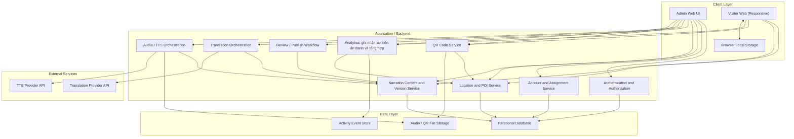

~~## 6. Component Diagram~~
**[ĐÃ SỬA 16/11] (loại bỏ vì tài liệu gốc không có, mã D12)** ## 6. Component Diagram
*(Ghi chú: Tài liệu gốc `dac_ta_use_case_hoan_chinh_v2.docx` chỉ là đặc tả Use Case nghiệp vụ, không quy định mô hình phân rã thành phần hệ thống Component Diagram. Sơ đồ này được giữ lại dưới dạng đề xuất kiến trúc kỹ thuật tham khảo).*

> Đây là **component decomposition đề xuất** từ trách nhiệm nghiệp vụ, không phải cấu trúc code/framework đã được đặc tả. Mọi ghi nhận sự kiện của Visitor đi qua Backend (Analytics), không ghi thẳng vào tầng dữ liệu. Có thể triển khai các service này thành module trong một modular monolith; không có căn cứ bắt buộc phải tách microservices. Kiểm tra quyền (Auth) áp dụng cho mọi lời gọi quản trị.

